# Módulo 4 · Integraciones avanzadas e interconexión de sistemas

**Checkpoint 4 – Pamela González**
Archivo del flujo: [`checkpoint4_pamela_gonzalez.json`](checkpoint4_pamela_gonzalez.json)

Este flujo es la evolución del Manager del Módulo 3 (memoria en Airtable + Router IA + Workers). No se armó desde cero: se duplicó el workflow del M3 y se le sumaron tres integraciones reales por **OAuth2** (HubSpot CRM, Gmail y Slack) más cuatro controles preventivos en el lienzo.

---

## 1. Credenciales OAuth2 activas (3 conexiones)

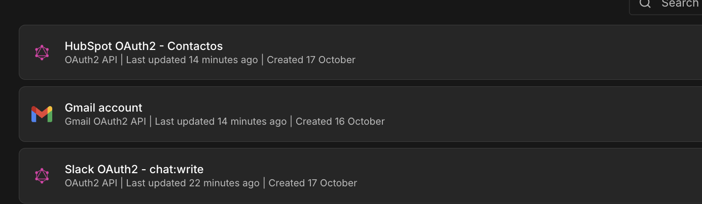

| Herramienta | Credencial en n8n | Tipo | Permisos (scopes) | Para qué se usa |
|---|---|---|---|---|
| **HubSpot CRM** (gratis) | HubSpot OAuth2 - Contactos | OAuth2 API genérica | `oauth`, `crm.objects.contacts.read`, `crm.objects.contacts.write` | Buscar (leer) y crear/actualizar (escribir) contactos. Nada más. |
| **Gmail** | Gmail account | Gmail OAuth2 | Los que define la credencial nativa de n8n | Leer correos entrantes (Trigger) y crear **borradores**. Nunca envía. |
| **Slack** (gratis) | Slack OAuth2 - chat:write | OAuth2 API genérica | Bot scope `chat:write` (sin user scopes ni eventos) | Publicar un aviso en `#operaciones`. |

**Mínimo privilegio:**
- **HubSpot:** el nodo nativo de n8n pide 13 scopes, así que se creó una app propia y una credencial OAuth2 genérica con solo 3.
- **Slack:** la app tiene un único permiso, `chat:write`, y está invitada solo al canal `#operaciones`.
- **Gmail:** la credencial nativa de n8n trae su propio paquete de permisos y no se puede recortar. Por eso el flujo se limita a **leer** y **crear borradores**: no hay ningún nodo "Send".

| HubSpot: scopes mínimos | HubSpot: conectado | Slack: solo `chat:write` | Slack: conectado |
|---|---|---|---|
| 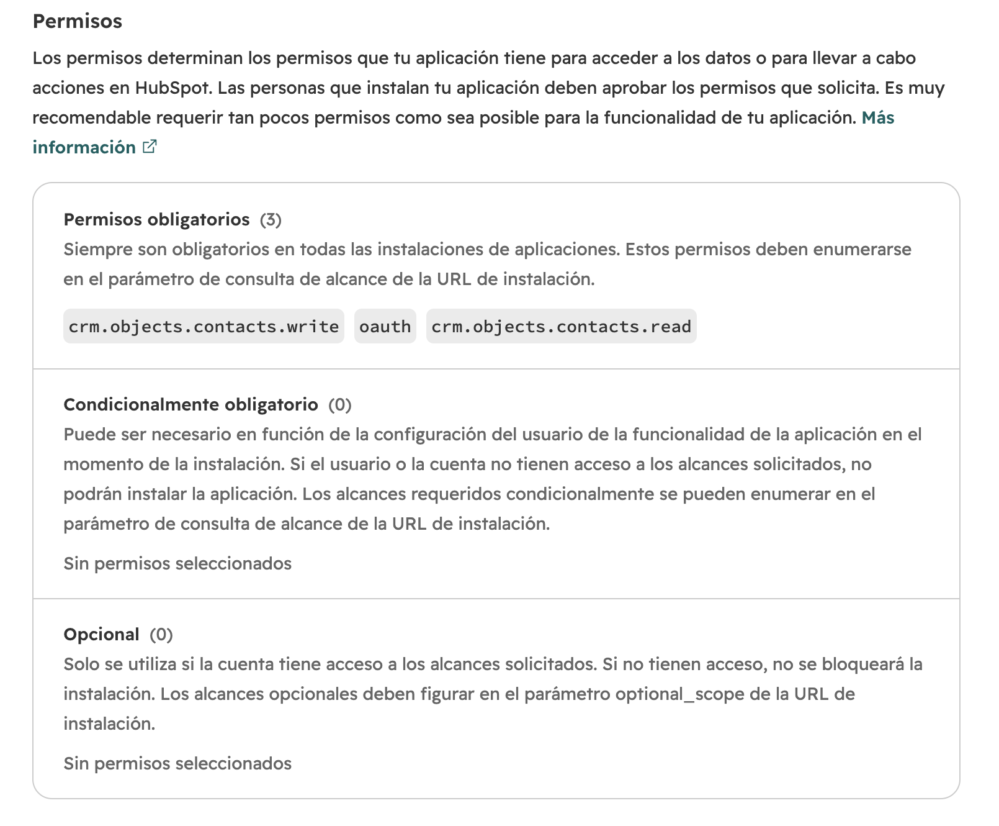 | 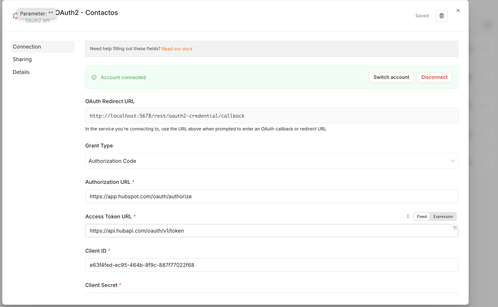 | 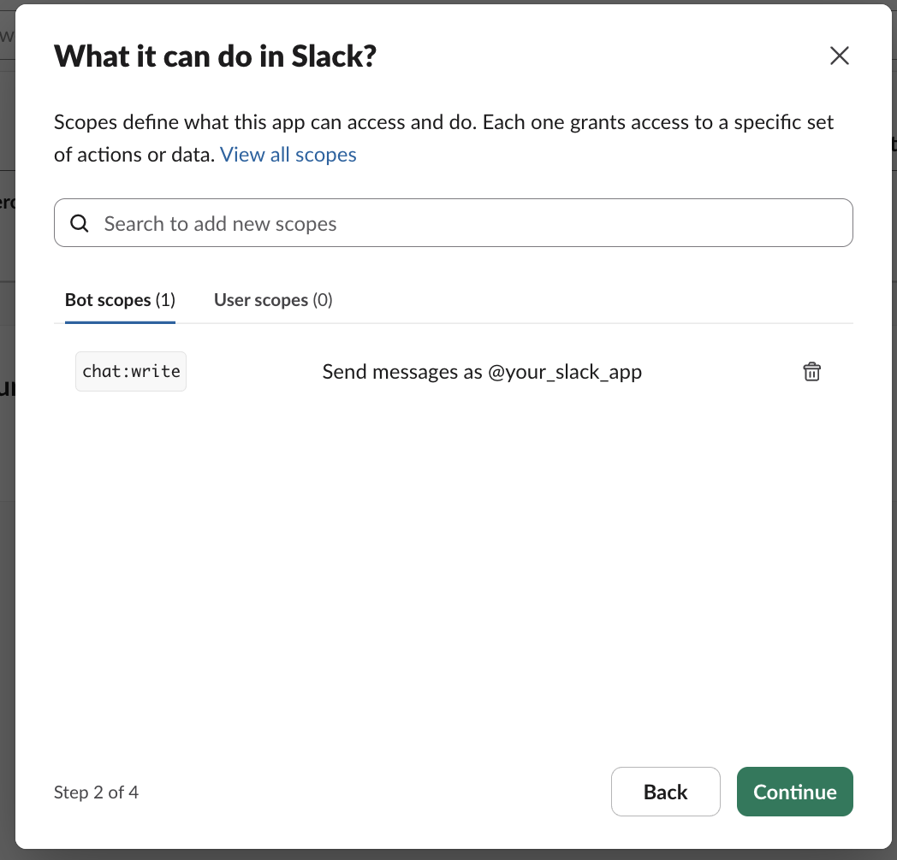 | 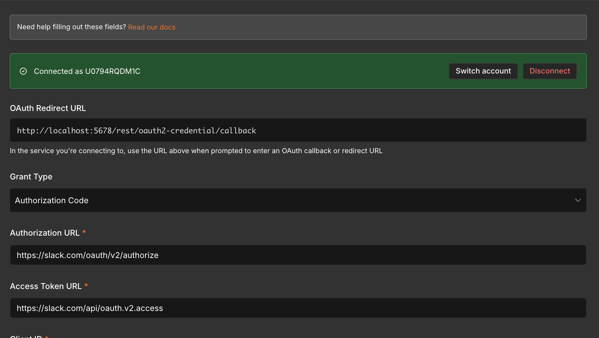 |

---

## 2. Cómo funciona el flujo

```
[Gmail Trigger - Correo Entrante]  (INBOX, no leídos, sin promociones, -from:me)
            │
            ▼
① [¿Es auto-reply?] ── Sí ─▶ [Stop - Auto-reply ignorado]
            │ No
            ▼
[Normalizar Correo]  (sessionId = email del remitente → memoria por cliente)
            │
            ▼
[Buscar Memoria → ¿Usuario existe? → Crear Memoria]        ← Airtable (M3)
            │
            ▼
[Router IA → Switch → Workers / Escalar / Error Worker]   ← Manager-Worker (M2)
            │
            ▼
[Agente con Memoria → Contar Mensajes → Resumen / Guardar Memoria]  ← (M3)
            │
            ▼
④ [Set - Limpiar Payload] → ④ [Filtro - ¿Email válido?]
            │
            ▼
② [Look up - ¿Contacto existe en HubSpot?] → [IF - ¿Contacto existe?]
        ┌───────────┴───────────┐
        Sí                      No
        ▼                       ▼
 [② Update contacto]     [② Create contacto]
        └───────────┬───────────┘
                    ▼
③ [Create Draft - Borrador para aprobación]   (Gmail, en el mismo hilo)
                    │
                    ▼
[Slack - Notificar #operaciones]   (aviso corto con payload limpio)
```

**Del chat al correo:** la entrada pasó de un Chat Trigger a un **Gmail Trigger**. El `sessionId` ahora es el correo del remitente, así que la memoria de Airtable sigue funcionando por cliente.

**Cambio respecto al M3:** se quitó el nodo "Reporte Gmail", que **enviaba** un correo interno a la misma casilla. Ese correo volvía a entrar por el Trigger y provocaba un **bucle**, además de incumplir la regla de "solo borradores". Su función de avisar al equipo ahora la cumple **Slack**. Además, el Trigger ignora los correos propios (`-from:me`).

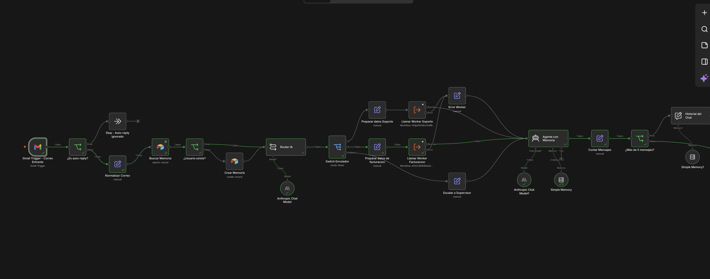
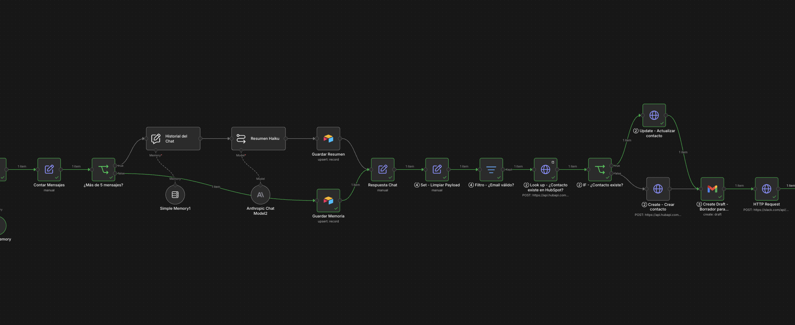

---

## 3. Los 4 nodos de la rúbrica

### ① IF anti auto-reply: corta el bucle infinito
Nodo **"¿Es auto-reply?"**, justo después del Gmail Trigger. Usa 6 condiciones unidas con **OR** y compara todo en minúsculas:
- El asunto contiene `auto-reply`, `out of office`, `undeliverable` o `respuesta automática`.
- El remitente contiene `no-reply` o `noreply`.

Si alguna se cumple, el correo va a **"Stop - Auto-reply ignorado"** (No Operation) y el flujo termina ahí. No se llama a la IA, no se toca el CRM y no se crea ningún borrador, así que dos respuestas automáticas nunca pueden contestarse entre sí.

### ② Look up antes del Create: evita el Error 409 (duplicado)
**"Look up - ¿Contacto existe en HubSpot?"** busca el contacto por email (`POST /crm/v3/objects/contacts/search`, con `email EQ from`). Tiene **Always Output Data** activado para que el flujo siga aunque no encuentre nada.

Después, **"IF - ¿Contacto existe?"** revisa `total > 0`:
- **Sí:** **Update** (PATCH al id encontrado).
- **No:** **Create** (POST con email, nombre y apellido).

Así nunca se intenta crear un contacto que ya existe, y HubSpot no responde con *409 Conflict*.

### ③ Create Draft: Human-in-the-loop
El único nodo de salida de correo es **Gmail → Draft → Create**:
- Guarda la respuesta redactada por la IA como **borrador**.
- La deja en el mismo hilo (Thread ID) y con el destinatario ya puesto (To Email).

Una persona la revisa y decide si la envía. **No existe ningún nodo "Send"** en el flujo.

### ④ Set de limpieza + validación: evita el Error 400 (payload mal formado)
**"Set - Limpiar Payload"** tiene *Include Other Input Fields* desactivado, así que deja solo estos campos:

| Campo | Contenido |
|---|---|
| `from` | Email del remitente, en minúsculas |
| `from_name` | Nombre del remitente, o vacío |
| `subject` | Asunto, con máximo 150 caracteres (si no hay, usa "(sin asunto)") |
| `bodyText` | Texto del correo sin saltos ni espacios extra, máximo 500 caracteres. Sin HTML ni adjuntos |
| `respuesta_ia` | Borrador redactado por el agente |
| `categoria` | Categoría del Router IA |

Luego, **"Filtro - ¿Email válido?"** deja pasar solo los correos que cumplen el formato `^[^@\s]+@[^@\s]+\.[^@\s]+$`. Así HubSpot, Gmail y Slack siempre reciben datos completos y bien formados.

---

## 4. Pruebas de regresión (3 ramas)

| Prueba | Correo | Resultado esperado | Resultado obtenido |
|---|---|---|---|
| **A. Cliente nuevo** | "No puedo descargar mi factura" | Create contacto + borrador + Slack | ✅ Slack: *"Contacto HubSpot: nuevo (creado)"*, categoría SOPORTE_TECNICO |
| **B. Cliente existente** | "Cobro duplicado en mi tarjeta" | Update (sin duplicar) + borrador + Slack | ✅ Slack: *"Contacto HubSpot: existente (actualizado)"*, categoría FACTURACION |
| **C. Auto-respuesta** | "Out of office: Respuesta automática" | Se detiene en el Stop | ✅ Terminó en *Stop - Auto-reply ignorado*. Nada en HubSpot, Gmail ni Slack |

| A. Contacto creado | A. Aviso en Slack |
|---|---|
| 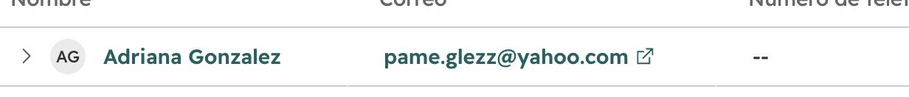 | 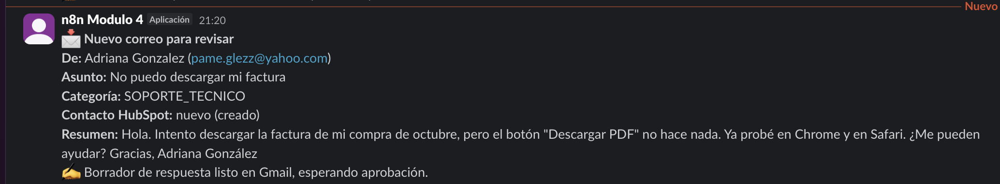 |

| B. Contacto existente | B. Aviso en Slack |
|---|---|
| 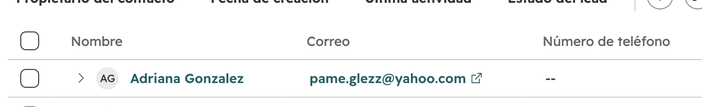 | 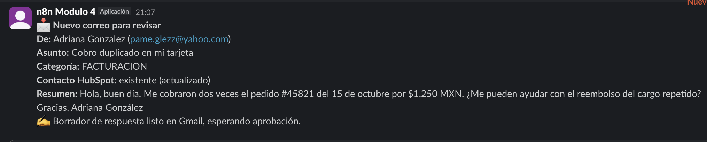 |

**C. Auto-reply detenido:**
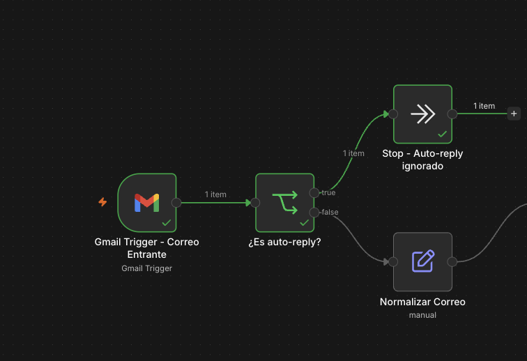

**Borrador listo para aprobación (no enviado):**
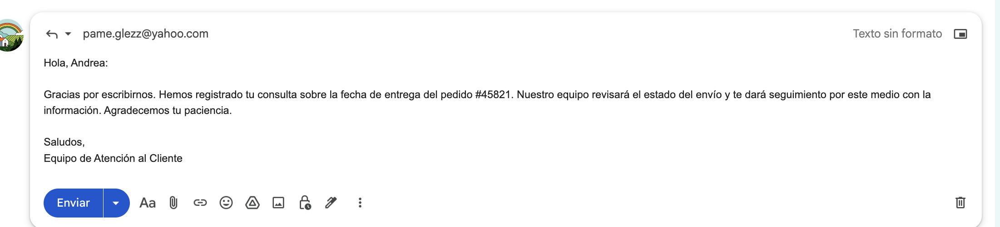

---

## 5. Seguridad del archivo exportado

- n8n **no exporta secretos**. En el `.json` las credenciales aparecen solo por nombre e id interno: no hay Client Secret, tokens ni contraseñas.
- No hay correos personales escritos a mano en ningún nodo. Todos se obtienen con expresiones a partir del correo entrante.
- `pinData` está vacío (no se guardaron datos de prueba) y el flujo se exporta **inactivo**.

## 6. Cómo importarlo

El archivo se probó importándolo en un workflow nuevo y vacío. Todos los nodos cargaron sin errores:

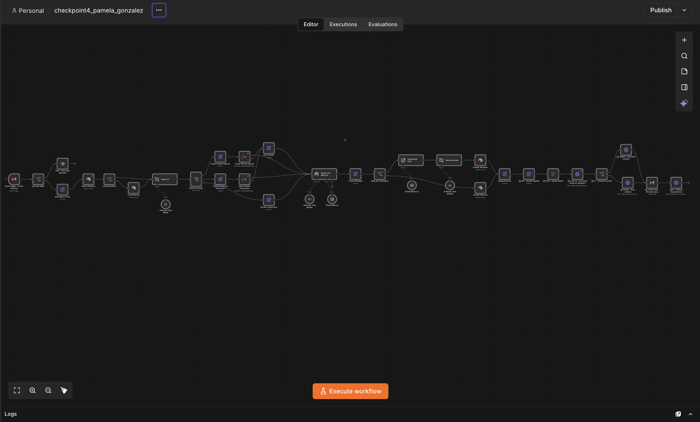

1. En n8n: **Create Workflow** → **⋯** → **Import from File…** → elegir `checkpoint4_pamela_gonzalez.json`.
2. Volver a seleccionar las credenciales propias en los nodos: Gmail, HubSpot (OAuth2 API), Slack (OAuth2 API), Anthropic y Airtable.
3. Los dos Workers del Módulo 2 (`worker1_soporte_tecnico`, `worker2_facturacion`) deben existir en la misma instancia.
4. En Slack, invitar la app al canal: `/invite @n8n Modulo 4` en `#operaciones`.
